<div align="center">
  <p><samp>OFF THE CLOCK</samp></p>
  <h1>One more chapter.</h1>
  <p>You found the quiet corner of this profile.</p>
</div>

<br />

<p align="center">
  
</p>

## Weekend Plans

```text
$ cargo run --bin weekend
error: cannot borrow `weekend` as mutable more than once
  first borrow:  books
  second borrow: side projects
  third borrow:  martial arts

help: consider adding another day to the week
```

<br />

<p align="center">
  <a href="../README.md">Back to my profile</a>
</p>
